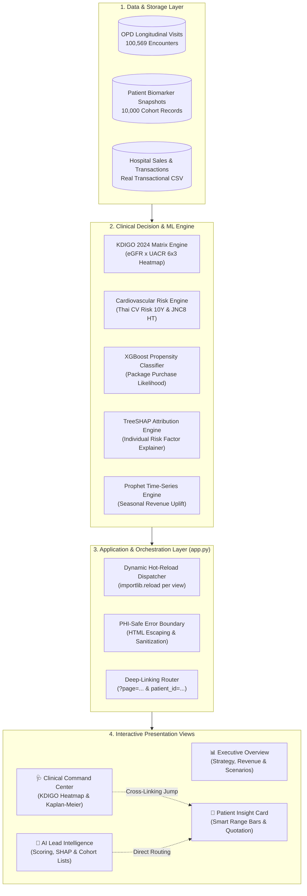

# 🏥 PrimeCare Wellness Clinic — Clinical Command Center & AI Intelligence Architecture

[](https://natchlimar-droid-project-dashboard-app-bqvoof.streamlit.app/)
[](https://github.com/natchlimar-droid/Project-Dashboard/actions/workflows/ci.yml)


> **Executive Case Study & Portfolio Project:** ระบบศูนย์บัญชาการข้อมูลคลินิกอัจฉริยะ (Clinical Command Center) และระบบคัดกรองแพ็กเกจสุขภาพเชิงรุกรายบุคคลด้วย **Explainable AI (XAI)** บนมาตรฐานเวชปฏิบัติสากลระดับโลก ออกแบบสำหรับโรงพยาบาลและคลินิกสุขภาพชั้นนำ

---

## 📌 สรุปภาพรวมและคุณค่าทางธุรกิจ (Executive Summary & Business Impact)

ในระบบบริการสุขภาพยุคปัจจุบัน โรงพยาบาลและคลินิกเวชกรรมส่วนใหญ่ยังคงดำเนินงานในรูปแบบ **"Passive Healthcare"** (รอให้ผู้ป่วยมีอาการป่วยแล้วจึงเข้ารับการรักษา) ส่งผลให้:
1. **ผู้ป่วยโรคเรื้อรัง (NCDs)** ขาดการติดตามเชิงรุกจนลุกลามสู่ภาวะแทรกซ้อนรุนแรง (เช่น ไตวายระยะสุดท้ายต้องล้างไต, โรคหลอดเลือดสมอง หรือหัวใจขาดเลือด)
2. **องค์กรสูญเสียโอกาสทางธุรกิจ** จากกลุ่มผู้รับบริการ OPD ทั่วไปที่มีความเสี่ยงสุขภาพแฝงแต่ไม่เคยซื้อแพ็กเกจตรวจสุขภาพเชิงลึก (Unconverted Non-Buyers)

**PrimeCare Clinical Intelligence** ถูกออกแบบขึ้นเพื่อแก้ปัญหานี้โดยทำหน้าที่เป็นสะพานเชื่อมระหว่าง **"ความเสี่ยงทางคลินิก (Clinical Risk Stratification)"** และ **"โมเดลธุรกิจตรวจสุขภาพเชิงป้องกัน (Preventive Package Monetization)"** ด้วยการนำข้อมูลเวชระเบียน 10,000 ราย และประวัติการตรวจกว่า 100,000 ครั้งมาวิเคราะห์ผ่าน AI ที่แพทย์และผู้บริหารสามารถตรวจสอบเหตุผลได้ทุกขั้นตอน (Explainable & Auditable AI)

---

## 🏗️ สถาปัตยกรรมระบบและการไหลของข้อมูล (System Architecture & Data Flow)



---

## 🔬 จุดเด่นทางเทคนิคและมาตรฐานทางการแพทย์ (Core Technical Highlights)

### 1. 🧪 ศูนย์ไต & ล้างไต (Renal & KDIGO 2024 Command Center)
- **KDIGO 2024 2D Heatmap Matrix:** จำแนกระดับความเสี่ยงโรคไตตามแนวทางสากล $6 \times 3$ ตาราง (GFR Stage G1–G5 ร่วมกับ Albuminuria Stage A1–A3) พร้อมรหัสสีเขียว/เหลือง/ส้ม/แดง และสัดส่วนผู้ป่วยรายกลุ่ม
- **Kaplan-Meier Renal Survival Curve:** แบบจำลองพยากรณ์อัตราการรอดชีวิตของไตโดยไม่ล้างไต (Non-ESRD Survival) ตลอดช่วงเวลา 60 เดือน (5 ปี) พร้อมตาราง Number of Patients at Risk Table
- **Rapid Decliners Detection:** คัดกรองผู้ป่วยที่ไตเสื่อมเร็วผิดปกติ ($\Delta\text{eGFR} < -5\text{ mL/min/ปี}$) เพื่อส่งต่ออายุรแพทย์โรคไตทันที

### 2. 🫀 ศูนย์ความดันโลหิตสูงและเบาหวาน (HT & DM Command Centers)
- **JNC 8 & Thai HT Guidelines:** จำแนกระดับความดันโลหิต Systolic/Diastolic BP พร้อมชาร์ตแนวโน้ม Cohort รายไตรมาส (Longitudinal Trend) เทียบเส้นเกณฑ์ $140/90\text{ mmHg}$
- **Glycemic Spectrum & DKD Risk:** วิเคราะห์การกระจายตัวของระดับ HbA1c และเชื่อมโยงความเสี่ยงเบาหวานลงไต (Diabetic Kidney Disease)

### 3. 🤖 Explainable AI (XAI) & Propensity Modeling
- **XGBoost Classifier:** ประเมินโอกาสในการซื้อแพ็กเกจสุขภาพตรวจเจาะลึก (Propensity Score 0–100%)
- **TreeSHAP Attribution:** แสดงผลค่าน้ำหนักปัจจัยเสี่ยง (SHAP Waterfall Chart) ให้แพทย์และทีมสุขภาพเห็นว่า AI แนะนำแพ็กเกจนี้เพราะเหตุผลใด (เช่น อายุ, ค่าความดันสูง, หรือค่าไตที่เริ่มลดลง)

### 4. 🔗 Seamless Cross-Linking & Deep Linking
- รองรับการกระโดดข้ามหน้าแบบสองทิศทางจากกลุ่มเสี่ยง NCDs ไปยังแฟ้มประวัติรายบุคคลฉบับเต็ม พร้อมส่ง Parameter ผ่าน URL เช่น:
  `https://natchlimar-droid-project-dashboard-app-bqvoof.streamlit.app/?page=patient&patient_id=605`

---

## 🛠️ รายการเทคโนโลยีและไลบรารีที่ใช้ (Tech Stack)

| ส่วนของระบบ | เครื่องมือ / ไลบรารี | วัตถุประสงค์การใช้งาน |
| :--- | :--- | :--- |
| **Web Framework** | `Streamlit >= 1.32.0` | สร้างเว็บแอปพลิเคชันโต้ตอบความเร็วสูง |
| **Data Processing** | `Pandas >= 2.0.0`, `NumPy >= 1.24.0`, `PyArrow` | วิเคราะห์ตารางข้อมูลขนาดใหญ่และประมวลผล Parquet |
| **Data Visualization** | `Plotly >= 5.18.0` | สร้างชาร์ต Scatter, Heatmap, Bar และ Kaplan-Meier Step Curve |
| **Machine Learning** | `XGBoost >= 2.0.0`, `Scikit-Learn >= 1.3.0` | โมเดล Gradient Boosting จำแนกและทำนายโอกาสการซื้อแพ็กเกจ |
| **Explainable AI** | `SHAP >= 0.44.0` | คำนวณ Shapley Additive Explanations ระดับบุคคล |
| **Time-Series Forecasting** | `Prophet >= 1.1.5` | พยากรณ์แนวโน้มยอดขายและผลตอบแทนส่วนเพิ่ม (Revenue Uplift) |
| **Testing & CI/CD** | `unittest`, `GitHub Actions` | ตรวจสอบคุณภาพโค้ดและรัน Automated Testing ก่อน Deploy |

---

## 📚 มาตรฐานทางการแพทย์และเอกสารอ้างอิง (Clinical References)

1. **KDIGO 2024 Clinical Practice Guideline for the Evaluation and Management of Chronic Kidney Disease:** Kidney International (2024) 105 (4S), S117–S314.
2. **2024 Thai Guidelines on the Treatment of Hypertension:** สมาคมความดันโลหิตสูงแห่งประเทศไทย (Thai Hypertension Society).
3. **Thai CV Risk Score:** แบบประเมินความเสี่ยงต่อการเกิดโรคหลอดเลือดหัวใจและสมอง โดยคณะแพทยศาสตร์โรงพยาบาลรามาธิบดี และการไฟฟ้าฝ่ายผลิตแห่งประเทศไทย (EGAT Study).
4. **Standards of Care in Diabetes (2024):** American Diabetes Association (ADA).

---

## 💻 วิธีการติดตั้งและรันในเครื่อง (Local Setup & Installation)

```bash
# 1. Clone repository
git clone https://github.com/natchlimar-droid/Project-Dashboard.git
cd Project-Dashboard

# 2. สร้าง Virtual Environment และเปิดใช้งาน
python -m venv .venv
# บน Windows:
.venv\Scripts\activate
# บน macOS/Linux:
source .venv/bin/activate

# 3. ติดตั้ง Dependencies
pip install -r requirements.txt

# 4. สั่งรันแอปพลิเคชัน
streamlit run app.py
```

เมื่อรันเสร็จสิ้น ให้เปิดเบราว์เซอร์ไปที่ `http://localhost:8501`

---

## 🧪 การรันชุดทดสอบ (Automated Unit Testing)

```bash
python -m unittest discover -s tests
```

---

## 👨‍💻 ข้อมูลนักพัฒนา & ผู้จัดทำ (Author & Contact)
- **Project Type:** Healthcare Analytics & Clinical Solutions Architecture Portfolio
- **Live Deployment:** [PrimeCare Wellness Clinic Dashboard](https://natchlimar-droid-project-dashboard-app-bqvoof.streamlit.app/)
